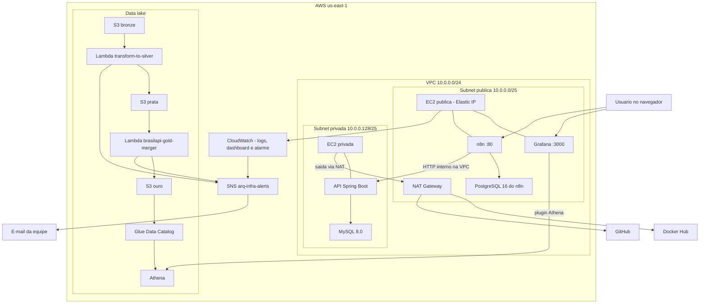
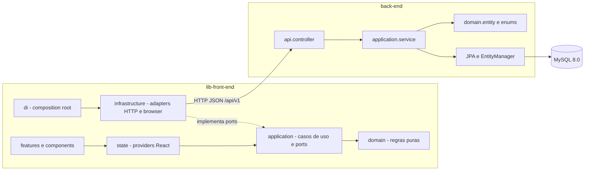

# PrimeLead Automation — Documento de Decisões Técnicas

| Campo | Valor |
| --- | --- |
| Versão do documento | 1.1 |
| Última atualização | 19/10/2026 |
| Repositórios | [automation-infra](https://github.com/PrimeLeadAutomation/automation-infra), [back-end](https://github.com/PrimeLeadAutomation/back-end), [lib-front-end](https://github.com/PrimeLeadAutomation/lib-front-end), [database_sql](https://github.com/PrimeLeadAutomation/database_sql) |

Este documento registra a arquitetura da solução, a stack tecnológica, as decisões técnicas com suas justificativas e os recursos externos utilizados ou planejados. Ele é versionado junto à infraestrutura e deve ser atualizado sempre que uma decisão for tomada, revista ou substituída (ver [Histórico de versões](#9-histórico-de-versões)).

---

## Sumário

1. [Visão geral da solução](#1-visão-geral-da-solução)
2. [Arquitetura proposta](#2-arquitetura-proposta)
3. [Stack tecnológica](#3-stack-tecnológica)
4. [Decisões técnicas e justificativas](#4-decisões-técnicas-e-justificativas)
5. [Ferramentas, serviços e recursos externos](#5-ferramentas-serviços-e-recursos-externos)
6. [Recursos adicionais planejados](#6-recursos-adicionais-planejados)
7. [Ambientes e fluxo de entrega](#7-ambientes-e-fluxo-de-entrega)
8. [Riscos, limitações e pendências técnicas](#8-riscos-limitações-e-pendências-técnicas)
9. [Histórico de versões](#9-histórico-de-versões)

---

## 1. Visão geral da solução

O PrimeLead é uma plataforma B2B de qualificação de leads. Cada empresa cliente (tenant) cadastra seus possíveis clientes, define o perfil de cliente ideal (ICP) e os pesos dos fatores de pontuação, e a plataforma calcula um score de 0 a 100 para cada lead, classificando-o como **ótimo**, **bom** ou **ruim**. O gestor acompanha a carteira, a equipe e as metas comerciais; os vendedores trabalham os leads atribuídos a eles.

Em paralelo à aplicação transacional, a solução mantém um pipeline de dados públicos de empresas (CNPJ e cadastros de sanções) em um data lake, consumido por dashboards analíticos para duas personas: **analista/SDR** e **diretoria**.

A solução é dividida em quatro repositórios:

| Repositório | Responsabilidade |
| --- | --- |
| `lib-front-end` | Interface web (SPA) para gestores e vendedores |
| `back-end` | API REST com regras de negócio, autenticação e persistência |
| `database_sql` | Modelagem, script de criação, migrações e massa de dados do banco relacional |
| `automation-infra` | Infraestrutura como código na AWS, pipeline de dados, monitoramento e dashboards |

---

## 2. Arquitetura proposta

### 2.1 Visão em camadas

A aplicação segue uma arquitetura em três camadas (apresentação, aplicação e dados), separada de uma trilha analítica independente:

- **Apresentação:** SPA React servida como arquivos estáticos por Nginx. Comunica-se com a API via HTTP/JSON.
- **Aplicação:** API REST stateless em relação aos dados (o estado de negócio fica no banco), com exceção das sessões de autenticação, hoje mantidas em memória (ver [seção 8](#8-riscos-limitações-e-pendências-técnicas)).
- **Dados transacionais:** MySQL 8.0, acessado exclusivamente pela API.
- **Trilha analítica:** data lake em S3 no padrão medalhão (bronze, prata e ouro), catalogado no Glue, consultado pelo Athena e visualizado no Grafana.

### 2.2 Arquitetura na nuvem (AWS)

**Rede**

- Uma VPC com uma subnet pública e uma privada na zona `us-east-1a`.
- A subnet pública tem rota para o Internet Gateway. A privada sai para a internet apenas pelo NAT Gateway, para baixar pacotes, a imagem do backend e o script do banco; ela não aceita conexões vindas da internet.
- O security group da instância privada libera somente SSH (22) e a porta da API para o bloco da própria VPC. O MySQL não publica porta fora da rede interna do Docker.

**Computação**

- **EC2 pública** (t3.small, Ubuntu 24.04): Grafana, n8n com PostgreSQL e pgAdmin, e agente do CloudWatch. Recebe um Elastic IP fixo para que a URL do Grafana não mude entre reinicializações.
- **EC2 privada** (t3.small, Ubuntu 24.04): API e MySQL em containers orquestrados por Docker Compose. No primeiro boot, o UserData instala o Docker, clona o repositório `database_sql` para inicializar o banco e baixa a última imagem publicada da API no Docker Hub.

**Dados e analytics**

- Três buckets S3 versionados (bronze, prata e ouro). Arquivos gravados no prefixo `to-process/` disparam a Lambda da etapa seguinte.
- O Glue Data Catalog (`arq_infra_db`) expõe os dados da camada ouro ao Athena, que tem um workgroup dedicado e grava resultados em `s3://<bucket-ouro>/athena-results/`.
- O Grafana consulta o Athena (view `vw_empresas`) para montar as dashboards das personas.

**Observabilidade e alertas**

- O agente do CloudWatch envia o syslog da instância pública ao grupo `/ec2/syslog`.
- Uma dashboard do CloudWatch mostra CPU, rede, saldo de EBS e logs da instância pública; um alarme de CPU publica no tópico SNS `arq-infra-alerts`.
- As Lambdas do pipeline publicam no mesmo tópico o resultado de cada etapa, com assuntos padronizados para sucesso e erro. O tópico entrega por e-mail ao endereço do projeto.

### 2.3 Arquitetura da aplicação

**Front-end.** Organizado em camadas com dependências apontando para o domínio (arquitetura de ports and adapters):

- `domain`: entidades, estratégia de pontuação (`WeightedScoringStrategy`, `FitRule`), análise de leads e serviços de domínio, sem dependência de React ou de I/O.
- `application`: casos de uso (`LoadWorkspace`, `LeadScoringService`) e interfaces (ports) de repositórios e recursos do navegador.
- `infrastructure`: implementações dos ports, como o cliente HTTP da API (`PrimeLeadApi`), `localStorage`, Web Audio e área de transferência.
- `di/container.ts`: único ponto que conhece as classes concretas.
- `features`, `components`, `layout` e `state`: telas, componentes reutilizáveis e providers de estado.

**Back-end.** Organizado por responsabilidade:

- `api.controller` e `api.error`: endpoints REST e tradução de erros de negócio em respostas HTTP.
- `application.service`, `application.dto` e `application.mapper`: casos de uso, contratos de entrada e saída e conversões.
- `domain.entity`, `domain.enums` e `domain.repository`: modelo de domínio mapeado com JPA.
- `persistence.converter`: conversão entre enums do Kotlin e valores do banco.
- `config`: sessões, autenticação por interceptor e CORS.

A API é exposta em `/api/v1`. Os endpoints privados exigem `Authorization: Bearer <token>` e toda consulta é filtrada pela empresa do usuário autenticado.

### 2.4 Arquitetura local de desenvolvimento

| Componente | Como sobe | Endereço |
| --- | --- | --- |
| Front-end (Vite) | `npm run dev` | `http://localhost:5173` |
| Front-end (Docker + Nginx) | `docker compose up --build` em `lib-front-end` | `http://localhost:8080` |
| API + MySQL (Docker) | `docker compose up --build -d` em `back-end` | `http://localhost:8081/api/v1` |
| API sem Docker | `mvnw spring-boot:run` com MySQL local | `http://localhost:8081/api/v1` |

No Compose do back-end, o MySQL é inicializado com o script-base e a migração V2 na primeira criação do volume, e não publica porta no host.

---

## 3. Stack tecnológica

### 3.1 Front-end

| Tecnologia | Versão | Uso |
| --- | --- | --- |
| TypeScript | 5.5 | Linguagem |
| React | 18.3 | Biblioteca de interface |
| React Router | 6.26 | Roteamento da SPA |
| Vite | 5.4 | Servidor de desenvolvimento e build |
| Vitest | 2.1 | Testes unitários do domínio e do cliente HTTP |
| Node.js | 20+ (build em Docker com 22) | Ambiente de build |
| Nginx | 1.27 (alpine) | Servidor dos arquivos estáticos em produção |
| CSS próprio com tokens | — | Estilização sem framework de UI |

### 3.2 Back-end

| Tecnologia | Versão | Uso |
| --- | --- | --- |
| Kotlin | 2.3.21 | Linguagem |
| Java (JDK/JRE Temurin) | 17 | Plataforma de execução |
| Spring Boot | 4.1.1 | Framework da aplicação |
| Spring Web MVC | via Boot | API REST |
| Spring Data JPA / Hibernate | via Boot | Mapeamento objeto-relacional |
| Spring Validation | via Boot | Validação de entrada |
| Spring Security Crypto | via Boot | Hash de senhas com BCrypt |
| Jackson Kotlin Module | via Boot | Serialização JSON |
| MySQL Connector/J | via Boot | Driver JDBC |
| Maven | 3.9 (wrapper 3.9.16) | Build e dependências |
| JUnit 5 + kotlin-test | via Boot | Testes |

### 3.3 Banco de dados

| Tecnologia | Uso |
| --- | --- |
| MySQL 8.0 | Banco relacional transacional |
| MySQL Workbench | Modelagem (`db_service.mwb`) e administração local |
| Scripts SQL versionados | Script-base, migração `V2__frontend_fields.sql` e massa de dados de desenvolvimento |

### 3.4 Infraestrutura, dados e operação

| Tecnologia | Uso |
| --- | --- |
| AWS CloudFormation | Infraestrutura como código, em stacks separadas por camada |
| Amazon VPC, Internet Gateway e NAT Gateway | Rede isolada com subnets pública e privada |
| Amazon EC2 (t3.small, Ubuntu 24.04 LTS) | Hospedagem dos containers |
| Elastic IP | Endereço fixo da instância pública |
| Docker Engine e Docker Compose | Execução e orquestração dos containers |
| Amazon S3 | Data lake em três camadas, com versionamento |
| AWS Lambda (Python 3.12) | Transformações do pipeline acionadas por eventos do S3 |
| AWS Glue Data Catalog | Catálogo das tabelas do data lake |
| Amazon Athena | Consultas SQL sobre o data lake |
| Grafana 12.4 + plugin Athena | Dashboards analíticas por persona |
| n8n + PostgreSQL 16 + pgAdmin | Automação de fluxos e integrações |
| Amazon CloudWatch | Logs, dashboard de infraestrutura e alarme |
| Amazon SNS | Alertas e notificações do pipeline por e-mail |
| Bash + AWS CLI | Script de provisionamento das stacks (`automation_bash.sh`) |

### 3.5 Ferramentas de desenvolvimento e colaboração

| Ferramenta | Uso |
| --- | --- |
| Git + GitHub (organização `PrimeLeadAutomation`) | Versionamento dos quatro repositórios |
| Docker Desktop | Execução local dos containers |
| Docker Hub | Registro da imagem da API |
| IntelliJ IDEA | Desenvolvimento do back-end |
| VS Code / Cursor | Desenvolvimento do front-end e da infraestrutura |

---

## 4. Decisões técnicas e justificativas

Cada decisão segue o formato: contexto, decisão, justificativa e consequências. Decisões substituídas devem ser marcadas como tal, sem serem removidas.

### DT-01 — Repositórios separados por camada

- **Decisão:** manter front-end, back-end, banco de dados e infraestrutura em quatro repositórios dentro da organização `PrimeLeadAutomation`.
- **Justificativa:** cada camada tem ciclo de vida, ferramentas de build e responsáveis diferentes. A separação permite que cada integrante trabalhe de forma independente e que a infraestrutura consuma apenas os artefatos de que precisa (imagem da API e scripts do banco).
- **Consequências:** mudanças que atravessam camadas exigem coordenação entre repositórios. Contratos compartilhados, como a URL da API, a porta e a ordem das migrações, precisam estar documentados.

### DT-02 — SPA em React com TypeScript e Vite

- **Decisão:** construir o front-end como Single Page Application em React 18 e TypeScript, com Vite como ferramenta de build.
- **Justificativa:** a interface é altamente interativa (simulação de score em tempo real, quadro kanban, painel lateral de lead). React tem ecossistema maduro e ampla documentação. TypeScript reduz erros de integração com a API ao tipar os contratos. Vite oferece build rápido e configuração mínima.
- **Consequências:** o resultado do build é um conjunto de arquivos estáticos, que pode ser servido por qualquer servidor HTTP ou CDN. A URL da API é embutida no build (`VITE_API_URL`) e precisa ser definida por ambiente.

### DT-03 — Arquitetura em camadas e princípios SOLID no front-end

- **Decisão:** separar domínio, casos de uso, adapters de infraestrutura e interface, com um composition root único (`di/container.ts`).
- **Justificativa:** as regras de pontuação e análise ficam testáveis sem navegador. A origem dos dados (repositórios em memória ou cliente HTTP da API) é trocada no composition root, sem que as telas dependam da implementação concreta.
- **Consequências:** há mais arquivos e interfaces do que em uma organização por tela, e novos recursos devem respeitar a direção das dependências.

### DT-04 — API em Kotlin com Spring Boot

- **Decisão:** implementar a API em Kotlin sobre Spring Boot 4 e Java 17, com build Maven.
- **Justificativa:** Spring Boot oferece de forma integrada o que o projeto precisa (REST, JPA, validação, criptografia de senhas) e é amplamente adotado no mercado. Kotlin traz null safety, data classes e menos código repetitivo, mantendo total interoperabilidade com o ecossistema Java. Java 17 é a versão LTS mínima exigida pelo Spring Boot 4.
- **Consequências:** a imagem de execução precisa de uma JVM, e o tempo de inicialização e o consumo de memória são maiores do que em runtimes mais leves. Isso é aceitável para o volume esperado.

### DT-05 — MySQL 8.0 como banco transacional

- **Decisão:** usar MySQL 8.0, com modelagem no MySQL Workbench.
- **Justificativa:** o domínio é relacional (empresas, usuários, leads, vínculos e versões de configuração) e exige integridade referencial e transações. O MySQL 8.0 oferece os recursos usados pela modelagem: colunas JSON para listas de tamanho variável, `CHECK`, chaves estrangeiras compostas, procedures e triggers.
- **Consequências:** a solução usa dois bancos relacionais distintos: MySQL para a aplicação e PostgreSQL apenas como armazenamento interno do n8n (DT-15).

### DT-06 — Esquema controlado por scripts versionados, sem geração automática

- **Decisão:** o esquema é criado pelo script-base e evoluído por migrações numeradas (`migrations/V2__frontend_fields.sql`). A API roda com `spring.jpa.hibernate.ddl-auto=validate`.
- **Justificativa:** o banco é modelado e revisado de forma independente da aplicação, e o script-base deve permanecer fiel à modelagem. Com `validate`, o Hibernate apenas confere se as entidades correspondem às tabelas e impede a inicialização em caso de divergência, sem alterar a estrutura.
- **Consequências:** as migrações são aplicadas manualmente ou na primeira inicialização do container do MySQL, e não são idempotentes. A adoção de uma ferramenta de migração (Flyway ou Liquibase) fica registrada como evolução possível.

### DT-07 — Multi-tenant por empresa em banco compartilhado

- **Decisão:** todas as empresas clientes compartilham o mesmo banco, e cada operação da API é filtrada pela empresa do usuário autenticado.
- **Justificativa:** é o modelo mais simples de operar para o porte do projeto (um único esquema e uma única instância). O isolamento é garantido na camada de aplicação, que exige a empresa em todos os contratos de repositório.
- **Consequências:** o banco sozinho não impede que um lead seja vinculado a mais de uma empresa. A API cria um registro de lead próprio por empresa, exclui registros legados compartilhados das consultas operacionais e bloqueia sua edição.

### DT-08 — Configuração de score versionada e imutável

- **Decisão:** cada alteração de pesos, limites de categoria e ICP gera uma nova versão. Versões publicadas não podem ser alteradas, e cada score calculado guarda a versão que o originou.
- **Justificativa:** permite rastrear por que um lead recebeu determinada nota e comparar resultados entre configurações. A publicação passa pela procedure `publicar_configuracao_score`, que valida os quatro fatores, a soma dos pesos igual a 100 e a presença do snapshot; triggers impedem alterações em versões publicadas.
- **Consequências:** o histórico de versões cresce a cada publicação. Ao publicar, a API recalcula os matches que têm todas as notas, o que precisará de processamento em lotes para carteiras grandes.

### DT-09 — Cálculo de score no back-end com prévia no front-end

- **Decisão:** a mesma fórmula de pontuação é implementada no front-end (`WeightedScoringStrategy`) e no back-end (`ScoreCalculator`). O front calcula prévias instantâneas; o back valida, calcula e persiste o valor oficial.
- **Justificativa:** o usuário vê o efeito de cada ajuste sem esperar a rede, e o valor gravado não depende de dados enviados pelo navegador, que poderiam ser manipulados. Notas não informadas não recebem valores inventados.
- **Consequências:** a fórmula existe em dois lugares e precisa ser mantida sincronizada, com testes nos dois lados (`WeightedScoringStrategy.test.ts` e `ScoreCalculatorTest.kt`).

### DT-10 — Autenticação por token opaco e senhas com BCrypt

- **Decisão:** o login emite um token aleatório de 256 bits, enviado como `Bearer`, com validade de 1 dia (ou 30 dias com "manter conectado"). Senhas são armazenadas com BCrypt. A cada requisição, o interceptor verifica se o usuário continua ativo na empresa.
- **Justificativa:** é uma solução simples, sem dependência de provedor externo, que permite revogação imediata no logout e na desativação do usuário. O BCrypt é o padrão recomendado para hash de senhas.
- **Consequências:** as sessões ficam na memória do processo. Reiniciar a API desconecta todos os usuários e impede a execução de mais de uma instância. A evolução prevista é persistir as sessões (no banco ou em um cache como Redis) ou migrar para JWT com lista de revogação.

### DT-11 — Containers Docker para todas as aplicações

- **Decisão:** front-end, API e banco rodam em containers. Os Dockerfiles usam build em múltiplos estágios: Node para gerar o front servido por Nginx, e Maven com JDK 17 para gerar o JAR executado em JRE 17.
- **Justificativa:** o mesmo artefato roda no Windows, no macOS e na EC2, eliminando diferenças de ambiente entre os integrantes. As imagens finais não contêm código-fonte nem ferramentas de build, o que reduz tamanho e superfície de ataque.
- **Consequências:** a equipe precisa de Docker Desktop. Imagens publicadas para a nuvem devem ser geradas para `linux/amd64`.

### DT-12 — Imagem da API distribuída pelo Docker Hub

- **Decisão:** a imagem da API é publicada em um repositório público do Docker Hub (`izabellefigueiredo1/primelead-backend:latest`) e a instância privada sempre baixa a tag `latest`.
- **Justificativa:** evita compilar a aplicação na EC2 (t3.small, 2 GB de memória), reduz o tempo de provisionamento e dispensa credenciais de registro na instância. O Docker Hub é gratuito para repositórios públicos.
- **Consequências:** a imagem fica acessível publicamente, portanto não pode conter segredos; senhas e URLs são fornecidas por variáveis de ambiente. Usar sempre `latest` simplifica a atualização, mas dificulta reverter versões; a adoção de tags versionadas fica registrada como melhoria.

### DT-13 — AWS como provedor de nuvem, com infraestrutura como código

- **Decisão:** provisionar toda a infraestrutura na AWS por meio de templates CloudFormation separados por camada (rede, mensageria, computação, armazenamento e monitoramento), executados em ordem pelo `automation_bash.sh`.
- **Justificativa:** o ambiente acadêmico disponibiliza a AWS (AWS Academy, com a role `LabRole` e o instance profile `LabInstanceProfile`). Infraestrutura como código permite recriar o ambiente do zero a cada sessão do laboratório, revisar mudanças por Git e manter as camadas desacopladas por meio de exports entre stacks.
- **Consequências:** as stacks dependem dos exports umas das outras e precisam ser criadas na ordem definida. O UserData só roda na criação da instância, então mudanças nele exigem recriar a instância.

### DT-14 — API e banco em subnet privada

- **Decisão:** a API e o MySQL rodam em uma instância sem IP público, acessível apenas de dentro da VPC.
- **Justificativa:** o banco nunca fica exposto à internet, e a API só recebe tráfego de componentes internos, como o n8n e um futuro proxy reverso. O acesso administrativo é feito por SSH passando pela instância pública.
- **Consequências:** para o navegador do usuário final alcançar a API, será necessário um ponto de entrada público (proxy reverso na instância pública ou um load balancer). Essa decisão está em aberto (ver [seção 8](#8-riscos-limitações-e-pendências-técnicas)).

### DT-15 — n8n para automações e integrações

- **Decisão:** hospedar o n8n na instância pública, com PostgreSQL próprio e pgAdmin para administração.
- **Justificativa:** o n8n permite construir fluxos de integração (ingestão de dados, chamadas à API, notificações) visualmente e sem novo código, acelerando experimentos. A versão self-hosted é gratuita e roda no mesmo padrão de containers da solução.
- **Consequências:** é mais um serviço a proteger e manter. As credenciais do n8n e do PostgreSQL precisam sair do template e passar a ser parâmetros secretos (ver [seção 8](#8-riscos-limitações-e-pendências-técnicas)).

### DT-16 — Data lake em camadas com processamento serverless

- **Decisão:** armazenar os dados públicos de empresas em três buckets S3 (bronze para dados brutos, prata para dados tratados e ouro para dados consolidados), com transformações em Lambdas acionadas por eventos do S3, catálogo no Glue e consultas no Athena.
- **Justificativa:** o padrão medalhão separa o dado bruto do dado pronto para análise e permite reprocessar etapas. Lambda, S3 e Athena cobram por uso e não exigem servidores ligados, o que é adequado para cargas eventuais. O versionamento dos buckets protege contra sobrescritas acidentais.
- **Consequências:** os nomes dos buckets são globais na AWS e estão fixos no template. As Lambdas publicam o resultado de cada etapa no SNS para que falhas não passem despercebidas.

### DT-17 — Grafana para dashboards analíticas

- **Decisão:** usar Grafana com o plugin de Athena e dashboards versionadas em JSON, uma por persona (analista/SDR e diretoria).
- **Justificativa:** o Grafana é gratuito, se conecta diretamente ao Athena sem cópia intermediária dos dados e permite versionar as dashboards no repositório. Separar por persona mantém cada painel focado nas decisões daquele público.
- **Consequências:** as consultas dependem da view `vw_empresas` no Athena e dos nomes de colunas da camada ouro; mudanças no pipeline precisam ser refletidas nas dashboards.

### DT-18 — Monitoramento com CloudWatch e alertas por SNS

- **Decisão:** coletar logs com o agente do CloudWatch, manter uma dashboard de infraestrutura e enviar alarmes e notificações do pipeline para um tópico SNS com assinatura por e-mail.
- **Justificativa:** são serviços nativos da AWS, sem custo adicional relevante no volume do projeto, e centralizam em um único canal (o e-mail do projeto) os alertas de infraestrutura e de dados.
- **Consequências:** hoje o monitoramento cobre apenas a instância pública; a extensão para a instância privada está nas pendências.

---

## 5. Ferramentas, serviços e recursos externos

Recursos que geram dependência fora do código da equipe, com sua justificativa e custo esperado.

| Recurso | Categoria | Uso no projeto | Justificativa | Custo | Status |
| --- | --- | --- | --- | --- | --- |
| AWS (EC2, VPC, NAT Gateway, Elastic IP, S3, Lambda, Glue, Athena, CloudWatch, SNS) | Nuvem | Hospedagem, pipeline de dados, monitoramento e alertas | Ambiente disponibilizado pela AWS Academy; ver DT-13 | Créditos do laboratório; NAT Gateway e EC2 são os itens de maior custo por hora | Em uso |
| GitHub | Versionamento | Repositórios da organização `PrimeLeadAutomation`; fonte dos scripts do banco no provisionamento | Padrão de mercado para colaboração; ver DT-01 | Gratuito | Em uso |
| Docker Hub | Registro de imagens | Distribuição da imagem da API | Evita build na EC2; ver DT-12 | Gratuito (repositório público) | Em uso |
| Imagens oficiais Docker (`mysql`, `nginx`, `node`, `maven`, `eclipse-temurin`, `postgres`, `grafana/grafana`, `n8nio/n8n`, `dpage/pgadmin4`) | Base de containers | Build e execução dos serviços | Imagens mantidas pelos fornecedores, com atualizações de segurança | Gratuito | Em uso |
| Grafana OSS + plugin Athena | Visualização | Dashboards por persona | Ver DT-17 | Gratuito | Em uso |
| n8n (self-hosted) | Automação | Fluxos de integração e automação | Ver DT-15 | Gratuito na versão self-hosted | Em uso |
| BrasilAPI | API pública de dados | Dados cadastrais de empresas por CNPJ, consolidados na camada ouro | API pública e gratuita, sem necessidade de chave | Gratuito | Em uso |
| Portal da Transparência — cadastros CEIS e CNEP | Dados públicos governamentais | Indicação de empresas sancionadas nas dashboards | Fonte oficial para avaliação de risco de leads | Gratuito | Em uso |
| Google Fonts (Sora, IBM Plex Sans, IBM Plex Mono) | CDN de fontes | Tipografia do front-end | Fontes livres e sem hospedagem própria; na indisponibilidade, o front usa fontes do sistema | Gratuito | Em uso |
| Provedor de IA (a definir) | API externa | Análise e chat sobre leads | Ver [seção 6.1](#61-provedor-de-ia-para-análise-de-leads) | A definir | Planejado |
| Serviço de e-mail transacional (a definir) | API externa | Convites e recuperação de senha | Ver [seção 6.2](#62-serviço-de-e-mail-transacional) | A definir | Planejado |
| Google Identity (OAuth 2.0) | Autenticação | Login com conta Google | Ver [seção 6.3](#63-login-com-google-oauth-20) | Gratuito | Planejado |

Recursos marcados como **Planejado** só entram no projeto após terem fornecedor, justificativa e custo definidos neste documento e alinhamento com a coordenação de PI.

---

## 6. Recursos adicionais planejados

Estes recursos já estão previstos na interface e na API, mas ainda não têm fornecedor escolhido. Os endpoints correspondentes respondem `501 Not Implemented` até a implementação.

### 6.1 Provedor de IA para análise de leads

- **Necessidade:** a tela de análise do front-end oferece diagnóstico, previsão, sugestão de ações e mensagens, e um chat sobre o lead. Hoje essa análise é local e determinística (`LeadAnalyzer`, `ChatResponder`), baseada em regras por categoria, sem chamada a serviço externo.
- **Uso previsto:** gerar análises e respostas em linguagem natural a partir dos dados do lead e da configuração de score.
- **TODO:**
  - Escolher o fornecedor e o modelo.
  - Definir que dados do lead podem ser enviados ao provedor, considerando a LGPD.
  - Estimar o custo por requisição e definir limites de uso.
  - Definir onde fica a chave de API (somente no back-end).
  - Registrar a decisão como nova DT.

### 6.2 Serviço de e-mail transacional

- **Necessidade:** convites de novos membros da equipe e recuperação de senha. Os endpoints `/auth/password/forgot` e `/auth/password/reset` e os de convite já existem e respondem 501.
- **TODO:**
  - Escolher o fornecedor (por exemplo, Amazon SES, por já estar na AWS, ou outro serviço de e-mail transacional).
  - Definir o domínio de envio e a configuração de SPF/DKIM.
  - Definir o modelo dos e-mails, a expiração dos links e o custo.

### 6.3 Login com Google (OAuth 2.0)

- **Necessidade:** a tela de login já exibe a opção de entrar com Google, e a rota `/auth/google/**` está reservada na API.
- **TODO:**
  - Criar o projeto no Google Cloud Console.
  - Definir as URLs de redirecionamento por ambiente.
  - Definir como vincular uma conta Google a um usuário e empresa existentes.
  - Definir o armazenamento seguro do client secret.

---

## 7. Ambientes e fluxo de entrega

| Ambiente | Front-end | API | Banco | Dados analíticos |
| --- | --- | --- | --- | --- |
| Local | Vite (`5173`) ou Docker + Nginx (`8080`) | Docker Compose ou Maven (`8081`) | MySQL em container ou local, com massa de dados de desenvolvimento | — |
| Nuvem (AWS Academy) | Hospedagem a definir (ver seção 8) | Container na EC2 privada | Container MySQL na EC2 privada | S3, Glue, Athena e Grafana |

**Fluxo de entrega atual**

1. **Código:** o desenvolvimento acontece na branch `main` de cada repositório.
2. **API:** a imagem é gerada localmente com `docker buildx build --platform linux/amd64` e publicada no Docker Hub com a tag `latest`.
3. **Infraestrutura:** o `automation_bash.sh` cria as stacks na ordem rede, mensageria, computação e armazenamento. Ele recebe por variáveis de ambiente o token de leitura do GitHub (`GITHUB_TOKEN`) e a senha do banco (`DB_PASSWORD`), que chegam ao CloudFormation como parâmetros ocultos.
4. **Atualização da API sem recriar a infraestrutura:** na instância privada, executar `docker compose pull && docker compose up -d` em `/opt/backend`.

**Segredos**

- Nenhuma senha é versionada.
- Os arquivos `.env` locais são ignorados pelo Git; os repositórios mantêm apenas `.env.example`.
- Na nuvem, as senhas entram como parâmetros `NoEcho` do CloudFormation. A evolução recomendada é usar o AWS Secrets Manager.

---

## 8. Riscos, limitações e pendências técnicas

### Integração entre repositórios

| Item | Impacto | Ação prevista |
| --- | --- | --- |
| A instância privada aplica apenas o script-base do banco, sem a migração V2 | A API não inicializa, porque o Hibernate em modo `validate` encontra tabelas ausentes | Montar também `migrations/V2__frontend_fields.sql` na inicialização do MySQL |
| Não há hospedagem definida para o front-end na nuvem, e a API não tem ponto de entrada público | O usuário final não acessa a aplicação na nuvem | Decidir entre Nginx com proxy reverso na instância pública ou bucket S3 com CloudFront, e ajustar `VITE_API_URL` e `CORS_ALLOWED_ORIGINS` |
| `VITE_API_URL` é embutida no build do front | Uma imagem construída para um ambiente não serve para outro | Gerar o build por ambiente ou servir front e API sob o mesmo domínio, com caminho relativo |

### Segurança

| Item | Impacto | Ação prevista |
| --- | --- | --- |
| Senhas do n8n, do PostgreSQL e do pgAdmin escritas no template de computação | Credenciais expostas no repositório | Transformar em parâmetros `NoEcho` ou usar o Secrets Manager, e trocar as senhas atuais |
| SSH (22), n8n (80) e Grafana (3000) da instância pública abertos para qualquer endereço | Superfície de ataque ampla | Restringir o SSH ao IP da equipe e avaliar HTTPS com proxy reverso |
| Tráfego HTTP sem TLS | Credenciais e tokens trafegam sem criptografia | Configurar HTTPS no ponto de entrada público |

### Aplicação

| Item | Impacto | Ação prevista |
| --- | --- | --- |
| Sessões de login em memória | Reiniciar a API desconecta todos os usuários; impede escalar para mais de uma instância | Persistir sessões (DT-10) |
| Recálculo da carteira inteira na publicação de uma configuração | Lentidão em carteiras grandes | Processamento em lotes ou em segundo plano |
| Plano e período de teste apenas como metadados | Não há cobrança nem controle de cotas | Fora do escopo atual; uma integração de pagamento exigiria nova DT e alinhamento |

### Infraestrutura e dados

| Item | Impacto | Ação prevista |
| --- | --- | --- |
| Handlers das Lambdas no template ainda são marcadores, e a lógica de transformação fica fora do repositório | O pipeline não pode ser reproduzido apenas pelo template | Versionar o código das Lambdas no `automation-infra` |
| Textos do template de armazenamento com caracteres corrompidos (codificação) | Assuntos e corpos dos e-mails do SNS com caracteres incorretos | Salvar o arquivo em UTF-8 e revisar os textos |
| Stack de monitoramento fora do `automation_bash.sh`, e cobertura apenas da instância pública | Monitoramento depende de execução manual e não cobre a API | Incluir a stack no script e adicionar métricas e logs da instância privada |
| Alarme de CPU com limite de 5% | Alertas frequentes sem relevância | Ajustar o limite após medir o uso real |
| Imagem da API sempre na tag `latest` | Dificulta reverter versões | Publicar tags versionadas e parametrizar a tag no template |
| Migrações SQL não idempotentes e aplicadas manualmente | Risco de execução duplicada ou fora de ordem | Avaliar Flyway ou Liquibase (DT-06) |

---

## 9. Histórico de versões

| Versão | Data | Alterações |
| --- | --- | --- |
| 1.0 | 19/10/2026 | Versão inicial: arquitetura, stack, decisões DT-01 a DT-18, recursos externos, recursos planejados e pendências técnicas |
| 1.1 | 19/10/2026 | Infraestrutura alinhada à porta `8081` da API (compose da instância privada, security group e output); pendência correspondente encerrada |

Para registrar uma nova decisão, adicione uma DT com o próximo número na seção 4. Se for um recurso externo, inclua-o também na seção 5. Em seguida, atualize a versão no topo do documento e registre a alteração nesta tabela. Decisões substituídas recebem a indicação "Substituída por DT-XX" e permanecem no documento.
